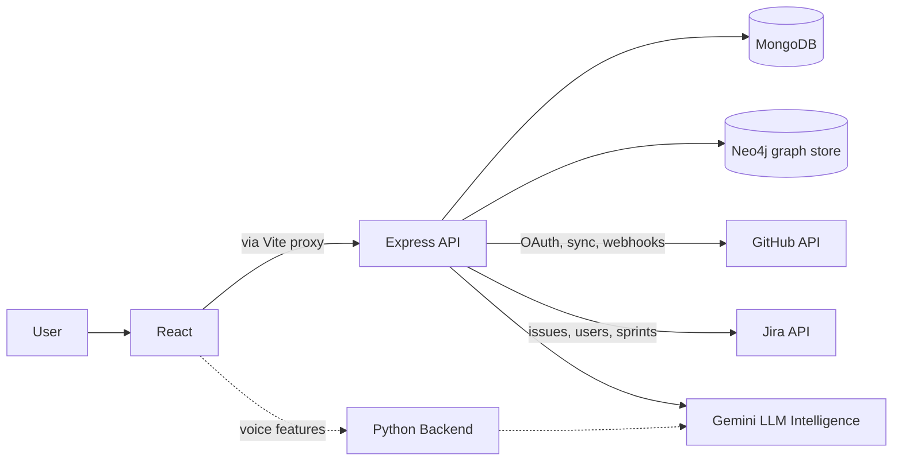

<p align="center">
  
</p>

# Kaizen Intelligence Platform

Kaizen is an enterprise engineering intelligence platform that turns GitHub, Jira, workforce, finance, and delivery telemetry into an operating view for project managers, engineering leaders, finance teams, and HR.

The repository contains a React/Vite dashboard, an Express API, MongoDB-backed domain services, an optional Neo4j knowledge graph integration, and an optional Python voice assistant.

<p align="center">
  
</p>

## Highlights

- Delivery overview with task completion, velocity, ROI, savings, and budget metrics
- Delivery forecasting and delay prediction
- Smart resource allocation and allocation simulation
- Finance and ROI reporting, including software capitalization signals
- HR performance and retention-risk views
- GitHub and Jira ingestion, synchronization, OAuth, and webhook routes
- 3D knowledge graph visualization for repositories, contributors, issues, and relationships
- Meeting transcript extraction and task-to-Jira workflows
- Optional voice-chatbot backend

---

<p align="center">
  
</p>

---


## System Architecture



## Repository Layout

```text
.
├── frontend/               React/Vite dashboard & UI components
│   ├── src/components/     Dashboard, landing, graph, and shared UI
│   ├── src/pages/          Dashboard routes and landing page
│   └── src/lib/            API, allocation, and LLM client services
├── backend/                Express API, domain services & integrations
│   ├── bot/                Optional Python voice & AI service
│   ├── config/             Database, environment, and Passport setup
│   ├── models/             Mongoose domain models
│   ├── routes/             API route modules
│   ├── services/           Allocation, ingestion, graph, Jira, and LLM services
│   ├── test/               Backend test and verification scripts
│   └── random/             Backend utilities and seed scripts
├── assets/                 Visual assets & documentation media
└── README.md
```

## Prerequisites

- Node.js 18 or newer
- npm
- MongoDB 6 or newer, local or hosted
- Python 3.10 or newer for the optional voice service
- Neo4j is optional and only required for graph synchronization features
- GitHub/Jira/Gemini credentials are optional for local UI exploration but required for their integrations

## Quick Start

### 1. Install dependencies

From the repository root:

```bash
# Frontend
cd frontend
npm install

# Backend
cd ../backend
npm install
```

For the optional voice service:

```bash
cd bot
python -m venv .venv

# macOS/Linux
source .venv/bin/activate

# Windows PowerShell
.venv\Scripts\Activate.ps1

pip install -r requirements.txt
```

### 2. Configure the API server

Create `backend/.env`:

```env
MONGODB_URI=mongodb://localhost:27017/kaizen
PORT=8000
FRONTEND_URL=http://localhost:5173
NODE_ENV=development

# Optional integrations
GEMINI_API_KEY=
GITHUB_CLIENT_ID=
GITHUB_CLIENT_SECRET=
GITHUB_CALLBACK_URL=http://localhost:8000/api/oauth/github/callback
JWT_SECRET=replace-this-in-development
GITHUB_DEFAULT_REPO=owner/repository
```

Do not commit credentials or production secrets. The server has development fallbacks, but production deployments should set every required secret explicitly.

### 3. Start the services

Use separate terminals:

```bash
# Terminal 1: API server
cd backend
npm run dev
```

```bash
# Terminal 2: Frontend
cd frontend
npm run dev
```

Open [http://localhost:5173](http://localhost:5173). The Vite development server proxies `/api` requests to `http://localhost:8000`.

The optional voice backend can be started according to its `app.py` configuration after installing its requirements.

## Available Commands

### Frontend

```bash
npm run dev       # Start Vite development server
npm run build     # Type-check and create a production build
npm run lint      # Run ESLint
npm run preview   # Preview the production build locally
```

### Server

```bash
npm run dev       # Start Express with nodemon
npm start         # Start Express with Node
npm run seed:mock
npm run seed:insights
npm run seed:roles
```

Seed commands require a reachable MongoDB instance and should be run only when you understand the data they insert.

---

## License

This project is licensed under the Apache License 2.0. See the [LICENSE](LICENSE) file for the full license text.

---