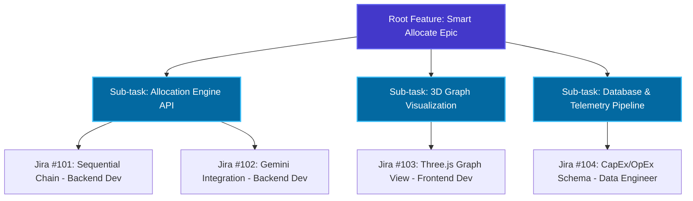

<p align="center">
  
</p>

<p align="center">
  <a href="https://react.dev/"></a>
  <a href="https://nodejs.org/"></a>
  <a href="https://www.python.org/"></a>
  <a href="https://ai.google.dev/"></a>
  <a href="https://www.mongodb.com/"></a>
  <a href="https://neo4j.com/"></a>
  <a href="LICENSE"></a>
</p>

---

### Core Problem

In modern software organizations, engineering activity—code commits, pull requests, backlog execution, and technical workflows—is trapped inside disconnected tools like GitHub, Jira, and manual status reports. This creates a critical operational blind spot: low-level technical signals remain completely isolated from high-level business metrics like delivery health, cost efficiency, productivity, and workforce utilization.

Without an automated bridge between technical execution and business strategy:
- **Delivery Delays are Caught Too Late:** Critical path bottlenecks and dependency risks remain invisible until release deadlines slip.
- **Resource Allocation Relies on Guesswork:** Headcount and task assignments are determined by subjective intuition rather than empirical codebase familiarity, velocity, and capacity.
- **Budget & Cost Tracking is Disconnected:** Engineering expenses cannot be tied directly to features, making software capitalization (CapEx/OpEx) and ROI measurement imprecise.
- **High Administrative Overhead:** Engineers and managers lose productive time manually writing tickets, preparing status updates, and context-switching across disparate platforms.

This operational divide forces engineering leaders, product managers, and HR teams into reactive decision-making rather than proactive, data-driven operational excellence.

<p align="center">
  
</p>

Kaizen bridges this operational divide by continuously connecting low-level technical telemetry (GitHub commits/PRs, Jira issues, CI/CD signals) with high-level business intelligence (financial capitalization, delivery forecasting, capacity allocation, and HR retention). By combining 3D knowledge graph intelligence with Google Gemini-powered reasoning and voice assistance, Kaizen eliminates blind spots and turns chaotic engineering signals into boardroom-ready clarity.

---

## Overview

**Kaizen** is an enterprise engineering intelligence platform that turns GitHub commits, pull requests, Jira backlog telemetry, workforce capacity, and financial data into actionable, boardroom-ready clarity.

Built around two dedicated operating views—the **Project Manager (PM) View** and the **HR View (People Ops)**—Kaizen bridges the divide between low-level technical execution and organizational strategy.

<p align="center">
  
</p>

---

## Table of Contents

- [Overview](#overview)
- [Key Features](#key-features)
- [System Architecture & Data Flow](#system-architecture--data-flow)
- [Key Capabilities](#key-capabilities)
  - [1. Knowledge Graph Engine](#1-knowledge-graph-engine)
  - [2. Smart Resource Allocation & Simulation](#2-smart-resource-allocation--simulation)
  - [3. Delay Prediction & Risk Mitigation](#3-delay-prediction--risk-mitigation)
  - [4. Meeting Intelligence & Auto-Ticketing](#4-meeting-intelligence--auto-ticketing)
  - [5. Voice-Enabled Conversational Assistant](#5-voice-enabled-conversational-assistant)
  - [6. Financial Intelligence (CapEx/OpEx Tracking)](#6-financial-intelligence-capexopex-tracking)
  - [7. HR Performance Analytics](#7-hr-performance-analytics)
  - [8. Role-Based Dashboards (PM & HR Views)](#8-role-based-dashboards-pm--hr-views)
- [Usage Examples](#usage-examples)
  - [Smart Resource Allocation with Graph Expansion](#smart-resource-allocation-with-graph-expansion)
  - [Delay Prediction](#delay-prediction)
  - [Meeting Auto-Ticketing](#meeting-auto-ticketing)
  - [Voice Assistant](#voice-assistant)
  - [HR Performance Review](#hr-performance-review)
- [Business Impact](#business-impact)
- [Security & Compliance](#security--compliance)
- [Technology Stack](#technology-stack)
- [Repository Layout](#repository-layout)
- [Prerequisites](#prerequisites)
- [Quick Start](#quick-start)
  - [1. Clone and Install Dependencies](#1-clone-and-install-dependencies)
  - [2. Configure Environment Variables](#2-configure-environment-variables)
  - [3. Seed Database (Optional)](#3-seed-database-optional)
  - [4. Start Development Servers](#4-start-development-servers)
- [Roadmap](#roadmap)
- [License](#license)

---

## Key Features

| Key Feature | Capability & Implementation | Enterprise Value |
| :--- | :--- | :--- |
| **Real-Time Sync** | Daily automated GitHub/Jira ingestion of commits, pull requests, branches, and backlog tickets | Unified single source of truth across engineering tools |
| **AI-First Design** | GenAI models for dynamic resource allocation, predictive delay scoring, and executive insights | Replaces subjective guesswork with data-backed planning |
| **Hierarchical LLM Chains** | Recursive task decomposition expanding high-level epics into sub-tasks with node-by-node growth | Automated Work Breakdown Structure (WBS) generation |
| **Automated Jira Generation** | Graph nodes convert automatically into Jira tickets with full hierarchy (Epic → Story → Sub-task) | Zero manual ticket drafting overhead for team leads |
| **Visual Simulation** | Interactive 3D knowledge graph growth animation with live engineer assignment preview | Risk-free "what-if" scenario planning before committing |
| **Multi-Tenancy** | Architectural partitioning scaling smoothly across enterprise organizations and squads | Enterprise-grade governance and squad isolation |
| **Adaptive Intelligence** | Dynamically recalculates recommendations as deadlines, priorities, and capacities shift | Continuous alignment with fast-moving delivery milestones |
| **Actionable Insights** | Every risk prediction and bottleneck warning includes concrete remediation steps | Rapid, high-confidence decision-making and mitigation |
| **Voice-Enabled & Multimodal** | Hands-free business intelligence with conversational voice query and spoken response | Instant status updates on demand |
| **Multilingual Support** | Conversational queries and voice synthesis in English and regional languages (powered by GCP STT/TTS) | Accessible to globally distributed engineering teams |
| **Audit Trail** | Complete historical log of all decisions, approvals, and resource reallocations | Full compliance, governance, and audit transparency |

---

## System Architecture & Data Flow

<p align="center">
  
</p>

### Data Flow

```text
1. Ingestion Layer
   ├─ GitHub Webhooks → Commit data
   ├─ Jira API → Task/ticket data
   └─ Meeting transcripts → Action items

2. Processing Layer
   ├─ Knowledge Graph Builder (Neo4j)
   ├─ AI Allocation Engine (Gemini + LangChain)
   ├─ Hierarchical Task Expander (LangChain sequential chain)
   ├─ Delay Prediction Model (ML)
   └─ Financial Calculator (MongoDB)

3. Intelligence Layer
   ├─ Performance Analytics (aggregations)
   ├─ Risk Scoring (ML predictions)
   ├─ Graph Expansion Simulator (recursive LLM)
   └─ Recommendation Engine (AI suggestions)

4. Presentation Layer
   ├─ Role-Based Dashboards (React)
   ├─ Interactive Graph Visualization (Three.js)
   ├─ Multimodal Assistant (Flask + GCP services like STT/TTS)
   └─ Real-time Notifications (WebSockets)
```

---

## Key Capabilities

### 1. Knowledge Graph Engine
- **Dynamic Dependency Mapping**: Automatically builds and maintains a real-time knowledge graph from GitHub commit history, Jira tickets, and task relationships.
- **3D Visualization**: Interactive 3D knowledge graph showing code dependencies, contributor networks, and project hierarchies.
- **Conflict Detection**: Identifies potential merge conflicts, dependency bottlenecks, and collaboration friction points.
- **Team Network Analysis**: Maps who works with whom, expertise clusters, and communication patterns.

### 2. Smart Resource Allocation & Simulation
- **AI-Powered Task Assignment**: GenAI suggests optimal resource allocation based on:
  - Employee skills and tech stack proficiency
  - Current workload and availability
  - Historical performance and velocity
  - Budget and timeline constraints
  - Knowledge graph insights (who knows what code)
- **Interactive Hierarchical Graph Expansion**: After initial team allocation, watch the knowledge graph expand in real-time:
  - **Root Node**: High-level feature/epic from Smart Allocate
  - **First Expansion**: LLM breaks feature into sub-tasks based on complexity
  - **Node-by-Node Assignment**: At each graph node:
    - Another LLM call analyzes task requirements
    - Assigns specific team member based on role, expertise, and graph position (e.g., frontend dev for UI nodes, backend dev for API nodes)
    - Generates detailed Jira ticket with acceptance criteria
    - Creates dependencies between related nodes
  - **Visual Simulation**: Watch graph grow as tasks spawn sub-tasks, tickets get assigned, and dependencies link
  - **Automatic Jira Creation**: Each node produces a ready-to-publish Jira ticket with proper hierarchy (Epic → Story → Sub-task)
- **Simulation Features**:
  - Visualize team expansion at each project node
  - See real-time task breakdown and assignment flow
  - Predict bottlenecks and critical path dependencies
  - Test "what-if" scenarios for budget/timeline changes
  - Review complete work breakdown structure before committing
- **Dynamic Reallocation**: Daily progress analysis triggers automatic recommendations:
  - Detect delays early and suggest additional resources
  - Identify over-staffed areas for cost optimization
  - Balance workload across team members
  - Adjust based on CapEx/OpEx constraints

### 3. Delay Prediction & Risk Mitigation
- **Predictive Analytics**: ML models forecast project delays based on:
  - Commit velocity vs. sprint goals
  - Task completion rates and complexity trends
  - Team capacity and historical burn-down patterns
  - Dependency chain analysis
- **Proactive Alerts**: Early warning system for delivery risks.
- **Critical Path Analysis**: Surfaces hidden bottlenecks and structural risks across dependency paths.
- **Automated Interventions**: Suggests resource reallocation, scope adjustments, or timeline revisions.

### 4. Meeting Intelligence & Auto-Ticketing
- **AI Meeting Bot**: Attends meetings, transcribes conversations, and retains full context.
- **Automatic Jira Creation**: Extracts action items from meeting transcripts and creates Jira tickets with:
  - Proper assignment based on expertise
  - Realistic effort estimates
  - Linked dependencies and acceptance criteria
- **Manager Review Interface**: Track auto-generated tickets, approve/edit before publishing.
- **Memory Layer**: Maintains conversation history for continuous context across meetings.

### 5. Voice-Enabled Conversational Assistant
- **Natural Language & Voice Queries**: Ask real-time questions in English or regional languages (powered by Google Cloud Speech-to-Text and Text-to-Speech):
  - *"What is Shweta working on?"* — Inspects active deliverables (`KAN-103: CloudFront Distribution & WAF`) and architecture workstreams.
  - *"How is our sprint velocity?"* — Delivers live completion rates (e.g., 26 of 34 tasks closed, 76.5% velocity).
  - *"Who committed the most code this sprint?"* — Returns contributor rankings and commit volume metrics (e.g., Maitri leading with 62 commits).
- **Multilingual Support**: Supports spoken queries and voice synthesis in regional languages (e.g., *"श्वेता किस प्रोजेक्ट पर काम कर रही हैं?"*).
- **JIRA & GitHub Integration**: Fetches real-time commit telemetry and backlog tickets without context switching.
- **Voice-to-Voice**: Speak your query, get natural spoken responses alongside interactive dashboard data cards.
- **Execute Actions**: Dispatch voice commands directly (e.g., *"Assign that task to Maitri"*).

### 6. Financial Intelligence (CapEx/OpEx Tracking)
- **Sprint-Level Cost Analysis**: Track capital and operational expenses for each sprint:
  - Developer hourly rates × time spent
  - Infrastructure costs
  - Tool licensing and third-party services
- **Budget vs. Actual**: Real-time comparison of planned vs. actual spend.
- **ROI Calculation**: Measure engineering investment returns per feature/project.
- **Financial Forecasting**: Predict future costs based on current trajectory.

### 7. HR Performance Analytics
- **Automated Performance Reports**: End-of-project stats for each employee:
  - Code contribution metrics (commits, lines of code, PR reviews)
  - Task completion rate and velocity
  - Budget impact (cost per feature delivered)
  - Collaboration score (PR reviews, pair programming)
  - Technical impact (dependencies created, bugs introduced/fixed)
- **Appraisal Readiness**: AI-generated performance summaries for review cycles.
- **Promotion Recommendations**: Identify high performers and skill gaps.
- **Retention Risk Analysis**: Predict flight risk based on workload stress, engagement patterns.

### 8. Role-Based Dashboards (PM & HR Views)
Kaizen delivers two dedicated, role-tailored operating views accessible directly via the top navigation switcher:

- **Project Manager (PM) View**:
  - **Real-Time Delivery Dashboard**: Live visibility into sprint velocity, completed tasks, commit volume, deploy frequency, and release confidence.
  - **3D Knowledge Graph**: Interactive force-directed map of repositories, contributors, pull requests, and Jira tickets.
  - **Smart Resource Allocation & Simulator**: AI-powered task matching and recursive graph expansion sandbox.
  - **Monte Carlo Delay Prediction**: Milestone risk forecasting, critical path bottlenecks, and AI mitigation steps.
  - **Meeting Intelligence & Auto-Ticketing**: Audio and transcript ingestion with automated Jira ticket publishing.
  - **Financial Intelligence & ROI**: CapEx/OpEx tracking, sprint cost breakdowns, and ASC 350-40 capitalization telemetry.

- **HR View (People Ops)**:
  - **Employee Performance Analytics**: Objective metrics (commits, lines of code, PR review depth, and sprint completion velocity).
  - **Retention & Flight-Risk Modeling**: Workload stress indicators, burnout alerts, and engagement tracking.
  - **AI-Generated Appraisal Dossiers**: Quantifiable, bias-free summaries exported for review cycles.
  - **Skill Gap & Growth Recommendations**: Targeted training insights based on technology roadmap evolution.

---

## Usage Examples

### Smart Resource Allocation with Graph Expansion
1. Navigate to **"Smart Allocate"** from PM dashboard
2. Input feature requirements, tech stack, budget, timeline
3. Click **"Generate Allocation"** → AI suggests optimal team composition
4. Navigate to **"Allocation Simulation"** to see the magic:
   - **Graph Expansion Animation:** Watch the knowledge graph grow node-by-node
   - **Hierarchical Task Breakdown:** Root feature expands into sub-tasks automatically
   - **LLM-Powered Assignment:** At each node:
     - LLM analyzes task complexity and dependencies
     - Assigns team member based on role and graph position (e.g., frontend dev for UI nodes, backend dev for API nodes)
     - Generates Jira ticket with title, description, acceptance criteria, story points
     - Links parent-child relationships in graph
   - **Real-Time Ticket Generation:** See Jira tickets appear as graph expands
   - **Dependency Visualization:** Lines connect dependent tasks, showing execution order
5. Review complete work breakdown structure with all assigned tickets
6. Adjust parameters and re-simulate if needed
7. **Approve** → Auto-publish all Jira tickets to your project board



### Delay Prediction
1. After allocation, navigate to **"Delay Prediction"**
2. View ML-predicted risk scores for each task
3. See critical path analysis and bottlenecks
4. Get AI recommendations for mitigation
5. Apply suggested resource adjustments

### Meeting Auto-Ticketing
1. Upload meeting transcript or paste conversation
2. AI extracts action items, owners, deadlines
3. Review auto-generated Jira tickets
4. Edit/approve before publishing
5. Tickets automatically linked in knowledge graph

### Voice Assistant
1. Click the floating chatbot widget at the bottom-right corner of any screen.
2. Speak or type live queries using natural language:
   - *"What is Shweta working on?"*
   - *"How is our sprint velocity?"*
   - *"Who committed the most code this sprint?"*
3. Get spoken audio response (Google Cloud TTS) + rich visual dashboard cards.
4. Execute voice actions:
   - *"Assign that task to Maitri"*

### HR Performance Review
1. Switch to HR view
2. Select employee from list
3. View AI-generated performance report with:
   - Commit stats and code quality
   - Task velocity and completion rate
   - Budget impact and ROI
   - Collaboration metrics
4. Export report for appraisal meeting

---

## Business Impact

By transforming engineering operations into measurable business intelligence, organizations can identify delivery delays and cost risks early, improve planning accuracy, optimize workforce usage, and increase return on engineering investment. This reduces dependency on intuition and enables consistent, scalable operational excellence.

| Strategic Domain | Measurable Business Outcome | Operational Driver |
| :--- | :--- | :--- |
| **Predictable Delivery** | **40% reduction** in missed deadlines<br>**60% improvement** in sprint planning accuracy | Early ML delay detection & critical path bottleneck analysis |
| **Cost Optimization** | **25% reduction** in over-staffing<br>**Real-time CapEx/OpEx tracking** | Dynamic reallocation & automated budget overrun prevention |
| **Productivity Gains** | **30% faster** task assignment<br>**50% reduction** in context-switching | AI recommendations, voice assistant & meeting auto-ticketing |
| **Data-Driven HR** | **Objective performance metrics** replace subjective reviews | Telemetry-based velocity, code quality & proactive retention analytics |
| **Leadership Visibility** | **Real-time portfolio health** across all initiatives | Engineering ROI measurement for informed investment decisions |

---

## Security & Compliance

- **OAuth 2.0**: Secure third-party integrations (GitHub & Atlassian Jira).
- **Session Management**: Encrypted session tokens with secure state management.
- **RBAC**: Role-based access control with dedicated **Project Manager (PM)** and **HR** views.
- **Audit Logs**: Complete historical trail of all decisions, reallocations, and approvals.
- **Data Encryption**: At-rest and in-transit encryption standards.
- **GDPR Compliant**: Employee data privacy controls and telemetry governance.

---

## Technology Stack

<p align="center">
  
</p>

| Domain | Technologies & Libraries |
| :--- | :--- |
| **Frontend** | React 19, TypeScript, Vite, Tailwind CSS v4, Radix UI Primitives, Framer Motion, Lucide Icons, Three.js, React-Force-Graph-3D, Recharts, TanStack Query |
| **Backend API** | Node.js (>=18), Express 4, Mongoose (MongoDB 6+), Neo4j JavaScript Driver, Passport.js (GitHub OAuth 2.0), Node-Cron, Axios |
| **Multimodal Voice Bot** | Python 3.10+, Flask, Gunicorn, PyMongo, PyDub, Google GenAI SDK (`google-genai`), Requests |
| **AI & Speech Services** | Google Gemini (2.5 & 2.0 Flash via Vertex AI / GenAI), Google Cloud Speech-to-Text (STT), Google Cloud Text-to-Speech (TTS) |
| **Databases** | MongoDB Atlas (Document Store), Neo4j Aura (Graph Store) |
| **Integrations** | GitHub REST & Webhooks API, Atlassian Jira Cloud REST API |
| **DevOps & Cloud** | Google Cloud Run, Docker |

---

## Repository Layout

```text
.
├── frontend/                     # React 19 + TypeScript + Vite Dashboard
│   ├── src/
│   │   ├── components/           # UI components (3D Graph, Dashboard, VoiceBot, Navbars)
│   │   ├── pages/                # Route pages (SmartAllocate, DelayPrediction, FinanceROI, etc.)
│   │   ├── lib/                  # Client API callers, utils, and allocation helpers
│   │   └── App.tsx               # Main routing, role switching & layout shell
│   ├── package.json              # Frontend dependencies and scripts
│   └── vite.config.ts            # Vite proxy & Tailwind CSS configuration
│
├── backend/                      # Node.js + Express API & Domain Services
│   ├── bot/                      # Python Flask Voice & Multimodal Bot Service
│   │   ├── services/             # GCP STT/TTS, MongoDB connector & Insights engine
│   │   ├── app.py                # Flask entry point and voice endpoints
│   │   └── requirements.txt      # Python dependencies
│   ├── config/                   # Database, environment and Passport configuration
│   ├── middleware/               # Auth and request verification middlewares
│   ├── models/                   # Mongoose schemas (Task, User, Issue, Sprint, etc.)
│   ├── routes/                   # API routes (smartAllocate, finance, hr, jira, graph, chat)
│   ├── services/                 # Allocation engine, Jira client, Neo4j sync, Gemini LLM
│   ├── random/                   # Seeder scripts and sample data fixtures
│   ├── test/                     # Backend API & service integration test scripts
│   ├── index.js                  # Express application server entrypoint
│   └── package.json              # Backend dependencies and scripts
│
├── assets/                       # Media assets and architecture diagrams
├── LICENSE                       # Apache 2.0 License
└── README.md                     # Platform documentation
```

---

## Prerequisites

- **Node.js**: `v18.0.0` or newer
- **npm**: `v9.0.0` or newer
- **MongoDB**: `v6.0` or newer (Local instance or MongoDB Atlas URI)
- **Python**: `3.10` or newer *(required for the voice bot service)*
- **FFmpeg**: *(optional, required by `pydub` in the Python bot for audio format conversion)*
- **Neo4j Aura / Community**: *(optional, required for 3D Knowledge Graph synchronization)*
- **Google Cloud Service Account & Gemini API Key**: *(optional for local UI preview; required for AI allocation, voice transcription, and synthesis)*

---

## Quick Start

### 1. Clone and Install Dependencies

```bash
# Clone the repository
git clone https://github.com/shwet46/Kaizen.git
cd Kaizen

# Install backend dependencies
cd backend
npm install

# Install frontend dependencies
cd ../frontend
npm install

# Setup Python voice bot (optional)
cd ../backend/bot
python -m venv .venv
source .venv/bin/activate  # Windows: .venv\Scripts\Activate.ps1
pip install -r requirements.txt
```

---

### 2. Configure Environment Variables

Create a `.env` file in the root directory:

```env
NODE_ENV=development
PORT=8000
FRONTEND_URL=http://localhost:5173
MONGODB_URI=mongodb://localhost:27017/kaizen
GEMINI_API_KEY=your_gemini_api_key
VITE_GEMINI_API_KEY=your_gemini_api_key
GOOGLE_APPLICATION_CREDENTIALS=./gcloud-service-account.json
GOOGLE_CLOUD_PROJECT_ID=your_gcp_project_id
GOOGLE_CLOUD_PROJECT=your_gcp_project_id
GOOGLE_CLOUD_LOCATION=global
JWT_SECRET=your_jwt_secret
VITE_API_URL=http://localhost:8000/api
VITE_VOICE_CHATBOT_API=http://localhost:5001
JIRA_BASE_URL=https://your-domain.atlassian.net
JIRA_PROJECT_KEY=KAN
JIRA_EMAIL=your-email@example.com
JIRA_API_TOKEN=your_jira_api_token
GITHUB_DEFAULT_REPO=owner/repo
GITHUB_TOKEN=your_github_token
GITHUB_CLIENT_ID=your_github_client_id
GITHUB_CLIENT_SECRET=your_github_client_secret
GITHUB_CALLBACK_URL=http://localhost:8000/api/oauth/github/callback
NEO4J_URI=neo4j+s://your-instance.databases.neo4j.io
NEO4J_USER=neo4j
NEO4J_PASSWORD=your_neo4j_password
```

---

### 3. Seed Database (Optional)

```bash
cd backend
npm run seed:roles
npm run seed:mock
npm run seed:insights
```

---

### 4. Start Development Servers

Run each service in a separate terminal:

```bash
# Terminal 1: Backend API
cd backend
npm run dev
```

```bash
# Terminal 2: Frontend Dashboard
cd frontend
npm run dev
```

```bash
# Terminal 3: Voice Bot (Optional)
cd backend/bot
source .venv/bin/activate  # Windows: .venv\Scripts\Activate.ps1
python app.py
```

Open [http://localhost:5173](http://localhost:5173) in your browser.

---

## Roadmap

- [ ] **Multi-tenant support for enterprise customers**
- [ ] **Slack/Teams integration for meeting bot**
- [ ] **Advanced conflict resolution algorithms**
- [ ] **Custom ML model training per organization**
- [ ] **Mobile apps (iOS/Android)**
- [ ] **On-premise deployment option**
- [ ] **Advanced financial forecasting (cash flow, burn rate)**
- [ ] **Skill gap analysis and training recommendations**

---

## License

This project is licensed under the **Apache License 2.0**. See the [LICENSE](LICENSE) file for details.
