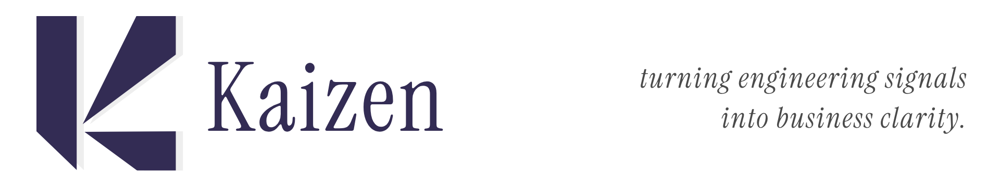
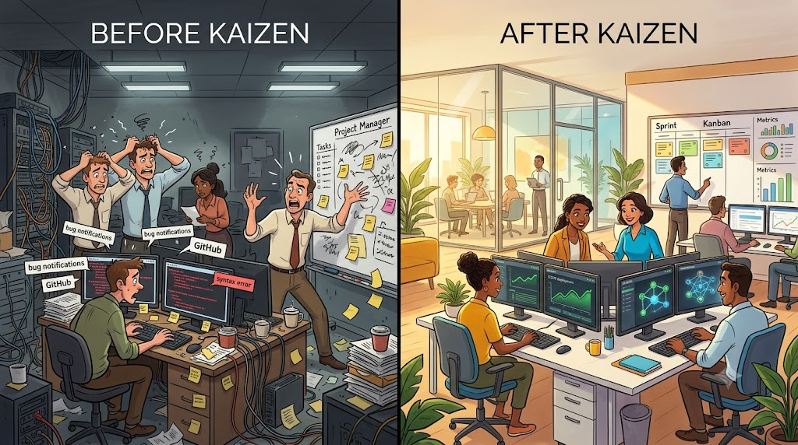
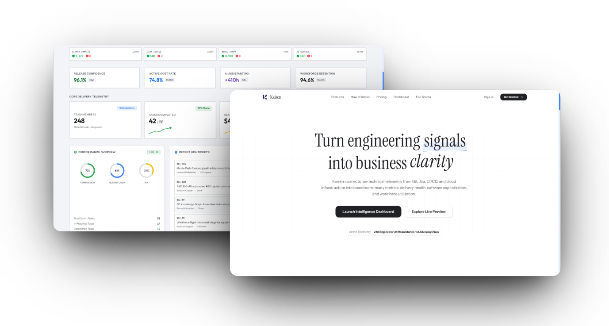
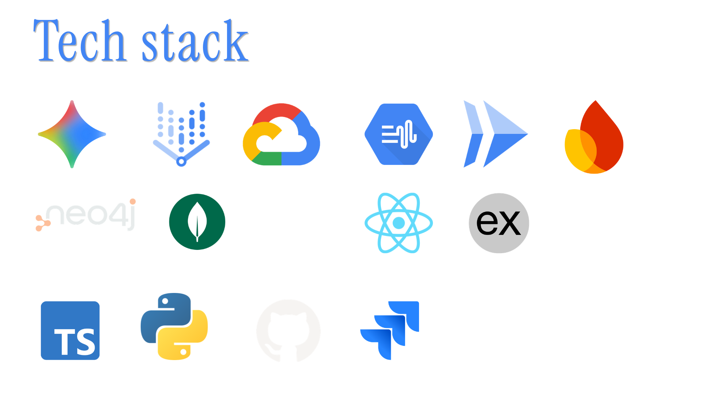
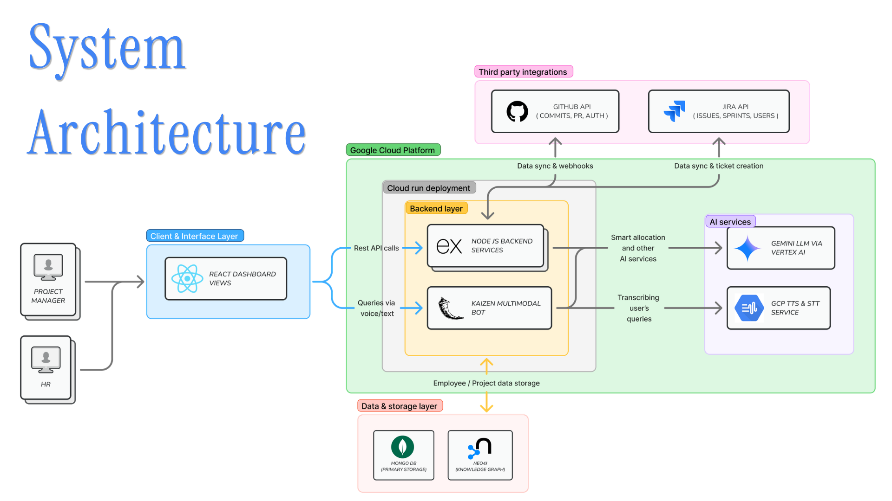

<p align="center">
  
</p>

<p align="center">
  <a href="https://react.dev/"></a>
  <a href="https://nodejs.org/"></a>
  <a href="https://www.python.org/"></a>
  <a href="https://ai.google.dev/"></a>
  <a href="https://www.mongodb.com/"></a>
  <a href="https://neo4j.com/"></a>
  <a href="LICENSE"></a>
</p>

---

**Core Problem:** Engineering teams rely on disconnected tools like GitHub, Jira, and manual reports, making it difficult to track delivery progress, allocate resources efficiently, and control project costs. Limited visibility into dependencies, workloads, and emerging risks leads to delayed releases, budget overruns, and reactive decision-making.

<p align="center">
  
</p>

Kaizen bridges this operational divide by continuously connecting low-level technical telemetry (GitHub commits/PRs, Jira issues, CI/CD signals) with high-level business intelligence (financial capitalization, delivery forecasting, capacity allocation, and HR retention). By combining 3D knowledge graph intelligence with Google Gemini-powered reasoning and voice assistance, Kaizen eliminates blind spots and turns chaotic engineering signals into boardroom-ready clarity.

---

## Overview

**Kaizen** is an enterprise engineering intelligence platform that turns GitHub commits, pull requests, Jira backlog telemetry, workforce capacity, and financial data into actionable, boardroom-ready clarity.

Built for **Project Managers**, **Engineering Leaders**, **Finance Teams (CFO / Controller)**, and **People Ops (HR)**, Kaizen bridges the divide between low-level technical execution and executive business strategy.

<p align="center">
  
</p>

---

## Table of Contents

- [Overview](#overview)
- [Key Capabilities](#key-capabilities)
  - [1. Engineering Delivery & Project Management](#1-engineering-delivery--project-management)
  - [2. Smart Allocation & Simulation Sandbox](#2-smart-allocation--simulation-sandbox)
  - [3. Monte Carlo Delay Prediction](#3-monte-carlo-delay-prediction)
  - [4. Finance & Software Capitalization (ASC 350-40)](#4-finance--software-capitalization-asc-350-40)
  - [5. HR Performance & Retention Risk Analysis](#5-hr-performance--retention-risk-analysis)
  - [6. 3D Interactive Knowledge Graph](#6-3d-interactive-knowledge-graph)
  - [7. Meeting Audio & Transcript-to-Jira Pipeline](#7-meeting-audio--transcript-to-jira-pipeline)
  - [8. Kaizen Multimodal Voice & Text Assistant](#8-kaizen-multimodal-voice--text-assistant)
- [Repository Layout](#repository-layout)
- [Prerequisites](#prerequisites)
- [Quick Start](#quick-start)
  - [1. Clone and Install Dependencies](#1-clone-and-install-dependencies)
  - [2. Configure Environment Variables](#2-configure-environment-variables)
  - [3. Seed Database (Optional)](#3-seed-database-optional)
  - [4. Start Development Servers](#4-start-development-servers)
- [License](#license)

---

## Key Capabilities

### 1. Engineering Delivery & Project Management
- **Unified Telemetry Dashboard**: Real-time visibility into active sprints, completed tasks, commit volume, deploy frequency, and velocity curves.
- **Bi-directional Jira & GitHub Sync**: Automated tracking of issues, active tickets, pull requests, and code review lifecycles.
- **Sprint Health & Confidence Scoring**: Algorithmic release confidence scores derived from commit velocity, ticket progress, and active blockers.

### 2. Smart Allocation & Simulation Sandbox
- **Multi-Factor Task Allocation**: Matches incoming tasks with the best-suited engineers using skill graphs, seniority, current workload, cost rate, and stress metrics.
- **Hierarchical & Streaming LLM Optimization**: Leverages Google Gemini to decompose complex feature requests and stream optimized allocation schedules.
- **Interactive Allocation Simulation**: PM sandbox allowing managers to simulate scenarios (e.g., adding resources, shifting deadlines, reassigning developers) and preview the impact before committing changes.

### 3. Monte Carlo Delay Prediction
- **Probabilistic Forecasting**: Runs stochastic delivery simulations taking into account past velocity, ticket weights, historical variance, and dependency chains.
- **Risk Attribution & Bottleneck Detection**: Flags at-risk milestones early, highlighting specific developers, tasks, or dependency bottlenecks causing potential delivery slippage.

### 4. Finance & Software Capitalization (ASC 350-40)
- **Automated R&D Capitalization Signals**: Automatically classifies engineering hours into capitalizable development assets versus operational maintenance expense.
- **ROI & Cost Efficiency Tracking**: Calculates active cost rate, projected burn rate, and real cost savings compared to external market contracting rates ($150/hr).
- **Audit-Ready Financial Reports**: Exports structured summaries ready for controllers, CFOs, and tax credit filings.

### 5. HR Performance & Retention Risk Analysis
- **Engineering Well-Being & Workload Index**: Balances task completion efficiency with stress indicators, avoiding developer burnout.
- **Predictive Retention & Flight-Risk Model**: Identifies potential churn risks using commit anomalies, ticket churn, workload imbalances, and engagement signals.
- **Tailored Retention Strategies**: Generates role-specific interventions and support plans for high-value talent.

### 6. 3D Interactive Knowledge Graph
- **Force-Directed Graph Exploration**: High-performance Three.js 3D knowledge graph modeling relations between Repositories, Contributors, Commits, Pull Requests, and Jira Tickets.
- **Knowledge Silo & Bus Factor Detection**: Pinpoints single points of failure where critical codebases or domains are owned by a single individual.
- **Neo4j Powered Relationship Queries**: Deep graph queries mapping developer-to-file affinities and code ownership.

### 7. Meeting Audio & Transcript-to-Jira Pipeline
- **Audio & Text Meeting Extraction**: Upload meeting audio or paste transcript logs from standups and planning sessions.
- **Automated User Story Extraction**: Google Speech-to-Text and Gemini extract user stories, acceptance criteria, required tech stacks, and estimated hours.
- **Direct 1-Click Jira Ticket Creation**: Generates validated Jira issues directly in your configured project board with assignees and priority.

### 8. Kaizen Multimodal Voice & Text Assistant
- **Conversational Intelligence**: Ask complex questions in natural voice or text (e.g., *"What is our release confidence for Sprint 4?"*, *"Who is overloaded on the backend team?"*).
- **Google Cloud Speech Integration**: Google Cloud Speech-to-Text (STT) and Text-to-Speech (TTS) for low-latency voice interactions.
- **Resilient Fallback Architecture**: Automatically degrades gracefully to a deterministic local intelligence engine if cloud AI quotas or prepayment limits are exceeded.

---

<p align="center">
  
</p>

| Domain | Technologies & Libraries |
| :--- | :--- |
| **Frontend** | React 19, TypeScript, Vite, Tailwind CSS v4, Radix UI Primitives, Framer Motion, Lucide Icons, Three.js, React-Force-Graph-3D, Recharts, TanStack Query |
| **Backend API** | Node.js (>=18), Express 4, Mongoose (MongoDB 6+), Neo4j JavaScript Driver, Passport.js (GitHub OAuth 2.0), Node-Cron, Axios |
| **Multimodal Voice Bot** | Python 3.10+, Flask, Gunicorn, PyMongo, PyDub, Google GenAI SDK (`google-genai`), Requests |
| **AI & Speech Services** | Google Gemini (2.5 & 2.0 Flash via Vertex AI / GenAI), Google Cloud Speech-to-Text (STT), Google Cloud Text-to-Speech (TTS) |
| **Databases** | MongoDB Atlas (Document Store), Neo4j Aura (Graph Store) |
| **Integrations** | GitHub REST & Webhooks API, Atlassian Jira Cloud REST API |
| **DevOps & Cloud** | Google Cloud Run, Docker |

---

<p align="center">
  
</p>

The platform follows a modern multi-tiered microservice architecture deployed on cloud infrastructure:

1. **Client & Interface Layer**:
   - Built with **React 19** and **Vite**, featuring tailored interfaces for **Project Managers** (Delivery, Allocation, Finance, 3D Graph) and **HR Teams** (Performance, Retention Risk).
   - Communicates with the Express API via standard REST endpoints and integrates the Kaizen voice widget.

2. **Cloud Run / Microservices Backend Layer**:
   - **Node.js / Express Core Services**: Orchestrates business domain logic, cron jobs, GitHub OAuth, MongoDB documents, and Neo4j graph synchronization.
   - **Kaizen Multimodal Bot (Python/Flask)**: Handles speech ingestion, transcription via GCP STT, conversational reasoning via Gemini, and synthesized audio responses via GCP TTS.

3. **Third-Party Integrations**:
   - **GitHub API**: Ingests commits, PR reviews, branches, author telemetry, and webhook events.
   - **Atlassian Jira API**: Synchronizes sprints, backlog issues, user workloads, and programmatically provisions tickets directly from meeting transcripts.

4. **AI & Speech Services**:
   - **Google Gemini LLM (via Vertex AI)**: Drives Smart Allocation, hierarchical task decomposition, delay risk modeling, and natural language analytics.
   - **GCP STT & TTS**: Provides real-time speech transcription and voice synthesis.

5. **Data & Storage Layer**:
   - **MongoDB Atlas**: Primary operational database storing users, employees, tasks, sprints, transcripts, and financial telemetry.
   - **Neo4j Aura**: Graph database mapping multi-dimensional relationships across code repositories, pull requests, developers, and Jira issues.

---

## Repository Layout

```text
.
├── frontend/                     # React 19 + TypeScript + Vite Dashboard
│   ├── src/
│   │   ├── components/           # UI components (3D Graph, Dashboard, VoiceBot, Navbars)
│   │   ├── pages/                # Route pages (SmartAllocate, DelayPrediction, FinanceROI, etc.)
│   │   ├── lib/                  # Client API callers, utils, and allocation helpers
│   │   └── App.tsx               # Main routing, role switching & layout shell
│   ├── package.json              # Frontend dependencies and scripts
│   └── vite.config.ts            # Vite proxy & Tailwind CSS configuration
│
├── backend/                      # Node.js + Express API & Domain Services
│   ├── bot/                      # Python Flask Voice & Multimodal Bot Service
│   │   ├── services/             # GCP STT/TTS, MongoDB connector & Insights engine
│   │   ├── app.py                # Flask entry point and voice endpoints
│   │   └── requirements.txt      # Python dependencies
│   ├── config/                   # Database, environment and Passport configuration
│   ├── middleware/               # Auth and request verification middlewares
│   ├── models/                   # Mongoose schemas (Task, User, Issue, Sprint, etc.)
│   ├── routes/                   # API routes (smartAllocate, finance, hr, jira, graph, etc.)
│   ├── services/                 # Allocation engine, Jira client, Neo4j sync, Gemini LLM
│   ├── random/                   # Seeder scripts and sample data fixtures
│   ├── test/                     # Backend API & service integration test scripts
│   ├── index.js                  # Express application server entrypoint
│   └── package.json              # Backend dependencies and scripts
│
├── assets/                       # Media assets and architecture diagrams
├── LICENSE                       # Apache 2.0 License
└── README.md                     # Platform documentation
```

---

## Prerequisites

- **Node.js**: `v18.0.0` or newer
- **npm**: `v9.0.0` or newer
- **MongoDB**: `v6.0` or newer (Local instance or MongoDB Atlas URI)
- **Python**: `3.10` or newer *(required for the voice bot service)*
- **FFmpeg**: *(optional, required by `pydub` in the Python bot for audio format conversion)*
- **Neo4j Aura / Community**: *(optional, required for 3D Knowledge Graph synchronization)*
- **Google Cloud Service Account & Gemini API Key**: *(optional for local UI preview; required for AI allocation, voice transcription, and synthesis)*

---

## Quick Start

### 1. Clone and Install Dependencies

```bash
# Clone the repository
git clone https://github.com/shwet46/Kaizen.git
cd Kaizen

# Install backend dependencies
cd backend
npm install

# Install frontend dependencies
cd ../frontend
npm install

# Setup Python voice bot (optional)
cd ../backend/bot
python -m venv .venv
source .venv/bin/activate  # Windows: .venv\Scripts\Activate.ps1
pip install -r requirements.txt
```

---

### 2. Configure Environment Variables

Create a `.env` file in the root directory:

```env
NODE_ENV=development
PORT=8000
FRONTEND_URL=http://localhost:5173
MONGODB_URI=mongodb://localhost:27017/kaizen
GEMINI_API_KEY=your_gemini_api_key
VITE_GEMINI_API_KEY=your_gemini_api_key
GOOGLE_APPLICATION_CREDENTIALS=./gcloud-service-account.json
GOOGLE_CLOUD_PROJECT_ID=your_gcp_project_id
GOOGLE_CLOUD_PROJECT=your_gcp_project_id
GOOGLE_CLOUD_LOCATION=global
JWT_SECRET=your_jwt_secret
VITE_API_URL=http://localhost:8000/api
VITE_VOICE_CHATBOT_API=http://localhost:5001
JIRA_BASE_URL=https://your-domain.atlassian.net
JIRA_PROJECT_KEY=KAN
JIRA_EMAIL=your-email@example.com
JIRA_API_TOKEN=your_jira_api_token
GITHUB_DEFAULT_REPO=owner/repo
GITHUB_TOKEN=your_github_token
GITHUB_CLIENT_ID=your_github_client_id
GITHUB_CLIENT_SECRET=your_github_client_secret
GITHUB_CALLBACK_URL=http://localhost:8000/api/oauth/github/callback
NEO4J_URI=neo4j+s://your-instance.databases.neo4j.io
NEO4J_USER=neo4j
NEO4J_PASSWORD=your_neo4j_password
```

---

### 3. Seed Database (Optional)

```bash
cd backend
npm run seed:roles
npm run seed:mock
npm run seed:insights
```

---

### 4. Start Development Servers

Run each service in a separate terminal:

```bash
# Terminal 1: Backend API
cd backend
npm run dev
```

```bash
# Terminal 2: Frontend Dashboard
cd frontend
npm run dev
```

```bash
# Terminal 3: Voice Bot (Optional)
cd backend/bot
source .venv/bin/activate  # Windows: .venv\Scripts\Activate.ps1
python app.py
```

Open [http://localhost:5173](http://localhost:5173) in your browser.

---

## License

This project is licensed under the **Apache License 2.0**. See the [LICENSE](LICENSE) file for details.
