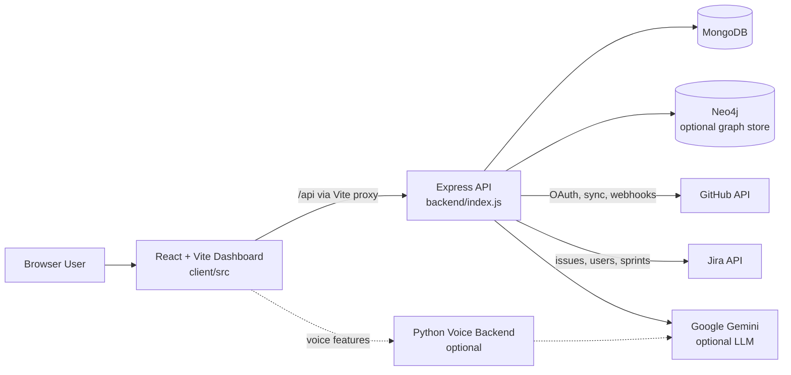

# Kaizen Intelligence Platform

Kaizen is an enterprise engineering intelligence platform that turns GitHub, Jira, workforce, finance, and delivery telemetry into an operating view for project managers, engineering leaders, finance teams, and HR.

The repository contains a React/Vite dashboard, an Express API, MongoDB-backed domain services, an optional Neo4j knowledge graph integration, and an optional Python voice assistant.

## Highlights

- Delivery overview with task completion, velocity, ROI, savings, and budget metrics
- Delivery forecasting and delay prediction
- Smart resource allocation and allocation simulation
- Finance and ROI reporting, including software capitalization signals
- HR performance and retention-risk views
- GitHub and Jira ingestion, synchronization, OAuth, and webhook routes
- 3D knowledge graph visualization for repositories, contributors, issues, and relationships
- Meeting transcript extraction and task-to-Jira workflows
- Optional voice-chatbot backend

## System Architecture



## Repository Layout

```text
.
├── client/                 React/Vite frontend
│   ├── src/components/     Dashboard, landing, graph, and shared UI
│   ├── src/pages/          Dashboard routes and landing page
│   └── src/lib/            API, allocation, and LLM client services
├── backend/                Express API and integrations
│   ├── config/             Database, environment, and Passport setup
│   ├── models/             Mongoose domain models
│   ├── routes/             API route modules
│   └── services/           Allocation, ingestion, graph, Jira, and LLM services
├── bot/                    Optional Python voice service
├── employee_data.json      Sample employee data
└── README.md
```

## Prerequisites

- Node.js 18 or newer
- npm
- MongoDB 6 or newer, local or hosted
- Python 3.10 or newer for the optional voice service
- Neo4j is optional and only required for graph synchronization features
- GitHub/Jira/Gemini credentials are optional for local UI exploration but required for their integrations

## Quick Start

### 1. Install dependencies

From the repository root:

```bash
cd client
npm install

cd ../backend
npm install
```

For the optional voice service:

```bash
cd ../bot
python -m venv .venv

# macOS/Linux
source .venv/bin/activate

# Windows PowerShell
.venv\Scripts\Activate.ps1

pip install -r requirements.txt
```

### 2. Configure the API server

Create `backend/.env`:

```env
MONGODB_URI=mongodb://localhost:27017/kaizen
PORT=8000
FRONTEND_URL=http://localhost:5173
NODE_ENV=development

# Optional integrations
GEMINI_API_KEY=
GITHUB_CLIENT_ID=
GITHUB_CLIENT_SECRET=
GITHUB_CALLBACK_URL=http://localhost:8000/api/oauth/github/callback
JWT_SECRET=replace-this-in-development
GITHUB_DEFAULT_REPO=owner/repository
```

Do not commit credentials or production secrets. The server has development fallbacks, but production deployments should set every required secret explicitly.

### 3. Start the services

Use separate terminals:

```bash
# Terminal 1: API server
cd backend
npm run dev
```

```bash
# Terminal 2: frontend
cd client
npm run dev
```

Open [http://localhost:5173](http://localhost:5173). The Vite development server proxies `/api` requests to `http://localhost:8000`.

The optional voice backend can be started according to its `app.py` configuration after installing its requirements.

## Available Commands

### Client

```bash
npm run dev       # Start Vite development server
npm run build     # Type-check and create a production build
npm run lint      # Run ESLint
npm run preview   # Preview the production build locally
```

### Server

```bash
npm run dev       # Start Express with nodemon
npm start         # Start Express with Node
npm run seed:mock
npm run seed:insights
npm run seed:roles
```

Seed commands require a reachable MongoDB instance and should be run only when you understand the data they insert.

## Dashboard Routes

The frontend exposes the following primary views:

| Route | Purpose |
| --- | --- |
| `/` | Landing page and interactive product preview |
| `/dashboard` | Project delivery overview |
| `/dashboard/graph` | 3D knowledge graph |
| `/dashboard/smart-allocate` | AI-assisted resource allocation |
| `/dashboard/delay-prediction` | Delay and delivery-risk analysis |
| `/dashboard/finance` | Finance and ROI reporting |
| `/dashboard/roles` | Role and access management |
| `/dashboard/allocation-simulation` | Allocation scenario modeling |
| `/dashboard/meeting-transcript` | Transcript-to-task workflow |
| `/dashboard/hr` | HR overview |
| `/dashboard/hr/performance` | Employee performance analytics |
| `/dashboard/hr/retention` | Retention-risk analysis |

## API and Data Integrations

The Express server organizes endpoints by domain under `backend/routes/`, including:

- `allocation`, `smartAllocate`, and `simulation` for staffing workflows
- `finance` and `insights` for reporting and intelligence
- `fetch`, `sync`, `github`, `jira`, and `webhooks` for external data
- `oauth` for GitHub authentication
- `hr`, `roles`, and `tasks` for workforce and work management
- `graph` for Neo4j-backed relationship views
- `chat` and `transcript` for assistant and meeting workflows

The frontend uses the `/api` prefix. Keep that prefix when adding client requests so local Vite proxying and production reverse-proxy rules remain consistent.

## Development Notes

- Keep dashboard-specific UI in `client/src/components` and `client/src/pages`.
- Keep shared primitives in `client/src/components/ui`.
- Add new API domains as isolated route modules under `backend/routes/`.
- Put external-service logic in `backend/services/`, not directly in route handlers.
- Use environment variables for credentials and deployment-specific URLs.
- Run `npm run build` before opening a pull request; it runs TypeScript validation through `tsc -b` before Vite builds the bundle.

## Troubleshooting

### The dashboard cannot reach the API

Confirm the API is running on port `8000`, the client is running on port `5173`, and the Vite proxy target in `client/vite.config.ts` matches the API port.

### MongoDB connection errors

Check `MONGODB_URI`, verify that MongoDB is running, and confirm that the selected database user has access to the database.

### GitHub OAuth redirects incorrectly

Set `GITHUB_CALLBACK_URL` to the callback registered in GitHub and set `FRONTEND_URL` to the URL where the frontend is running.

### The knowledge graph is unavailable

Neo4j is optional for the rest of the dashboard. Verify the Neo4j connection variables and graph service configuration before investigating frontend rendering.

## Security

- Never commit `.env` files, OAuth secrets, API keys, or JWT secrets.
- Use a strong, randomly generated `JWT_SECRET` outside local development.
- Restrict OAuth callback URLs to trusted environments.
- Treat ingested GitHub, Jira, HR, and finance data as sensitive operational information.

## License

No project license is currently declared. Add an explicit license before distributing this repository outside its intended organization.
